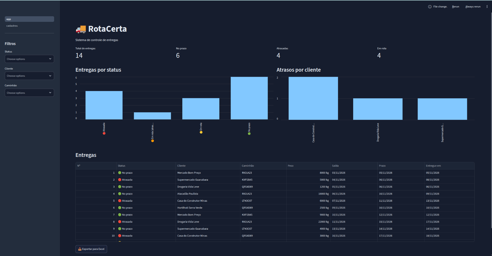
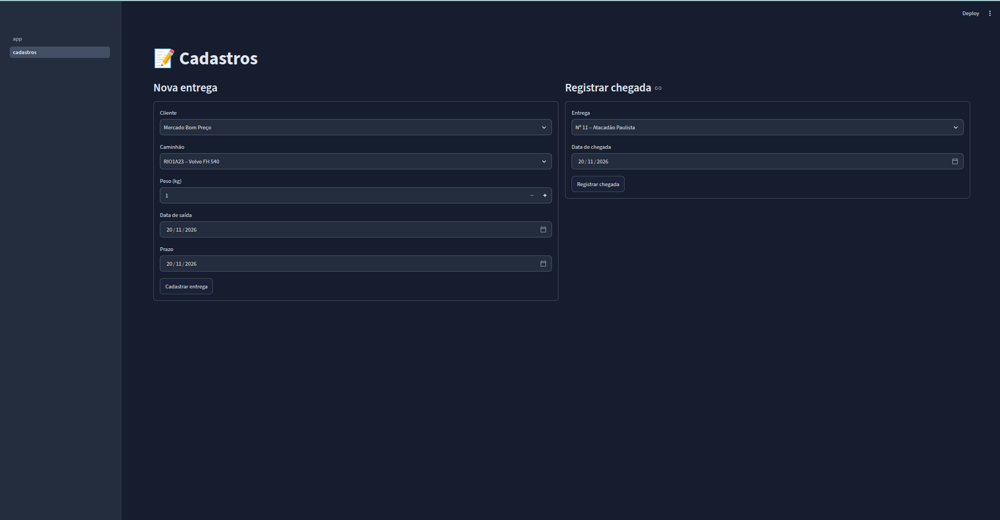

# 🚚 RotaCerta

Sistema web de controle de entregas para transportadoras, feito em Python.
Cadastra entregas, registra chegadas, classifica cada entrega automaticamente
(no prazo, atrasada ou em rota) e mostra os indicadores num painel interativo.

🔗 **Acesse o sistema:** _link em breve_



## Funcionalidades

- **Painel com indicadores:** total de entregas, no prazo, atrasadas e em rota
- **Status automático:** 🟢 No prazo · 🔴 Atrasada · 🟡 Em rota · 🟠 Em rota (atrasada)
- **Gráficos:** entregas por status e atrasos por cliente
- **Filtros** por status, cliente e caminhão, que atualizam cartões, gráficos e tabela
- **Exportação para Excel** da tabela filtrada
- **Cadastro de entregas** com validação (capacidade do caminhão e prazo)
- **Registro de chegada** das entregas em rota



## Tecnologias

- **Python**
- **SQLite**: banco de dados relacional com chaves estrangeiras
- **Pandas**: tratamento dos dados e regras de status
- **Streamlit**: interface web
- **openpyxl**: geração dos arquivos Excel

## Estrutura do projeto

```
rotacerta/
├── app.py               # Painel: indicadores, gráficos, filtros e tabela
├── pages/
│   └── 1_cadastros.py   # Cadastro de entregas e registro de chegadas
├── banco.py             # Conexão e criação das tabelas (SQLite)
├── cadastros.py         # Funções de acesso aos dados (INSERT, UPDATE, SELECT com JOIN)
├── dados_exemplos.py    # Dados de exemplo e criação automática do banco
└── .streamlit/
    └── config.toml      # Tema visual
```

## Como rodar no seu computador

```bash
git clone https://github.com/mateuskauadev/rotacerta.git
cd rotacerta
python3 -m venv .venv
source .venv/bin/activate        # no Windows: .venv\Scripts\activate
pip install -r requirements.txt
streamlit run app.py
```

O banco de dados é criado automaticamente com dados de exemplo na primeira execução.
Para voltar aos dados originais: `python dados_exemplos.py`.

## O que aprendi

- Modelar um banco relacional com chaves estrangeiras e consultar com `JOIN`
- Usar parâmetros `?` nas consultas SQL para evitar SQL injection
- Separar o código em camadas: banco, acesso aos dados e interface
- Aplicar regras de negócio em cada linha de uma tabela com `apply` no Pandas
- Validar os dados do usuário antes de gravar no banco
- Versionar o projeto com Git, com commits a cada etapa

## Autor

**Mateus Kauã Ferreira Corrêa**, estudante de Ciência da Computação na UERJ

[LinkedIn](https://www.linkedin.com/in/mateusfedev) · [GitHub](https://github.com/mateuskauadev)
